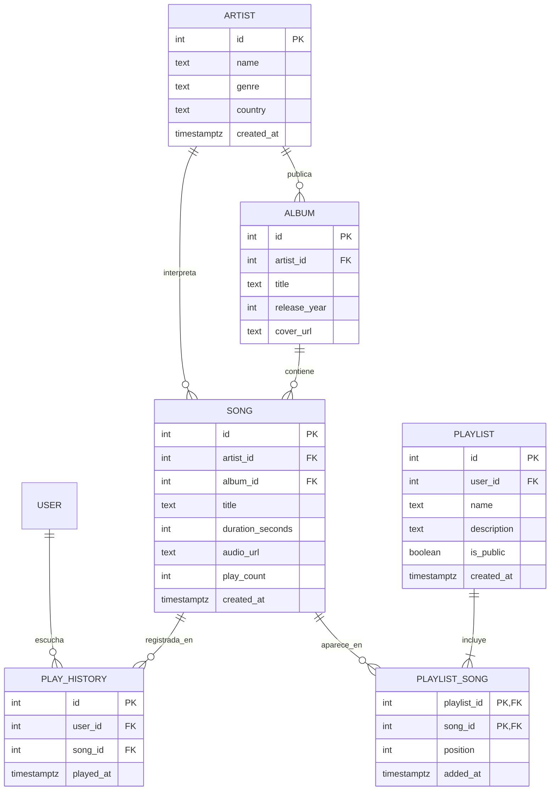

# PRD · <Rizumu Player>

> Documento de requisitos del producto (Product Requirements Document).
> Complétalo en el Sprint 0 (historia H0.3) y pide la aprobación del profesor en un Issue.
> Cada requisito funcional (RF) se convierte en un Issue con la plantilla "Historia de usuario".

| Campo | Valor |
| --- | --- |
| Alumno |María Díaz|
| Proyecto n.º |25|
| Sitio de referencia |Spotify|
| Compañero revisor |Julio Amundaray|
| URL desplegada | (se completa en el Sprint 5) |

## 1. Problema

Ofrece a los usuarios una experiencia fluida sin publicidad, en una interfaz web sencilla y ordenada donde se pueden armar listas de reproduccón, avanzar, retroceder y mezclar aleatoriamente las canciones con teclas multimedia.

## 2. Usuarios

- **Usuario principal:** Oyente que busca canciones y necesita una experiencia sin interrupciones de publicidad, controlando la reproducción desde el navegador.
- **Usuario secundario:** Administrador del catálogo musical que carga o modera canciones, artistas y álbumes.

## 3. Objetivo y métrica de éxito

Un usuario busca y encuentra una canción, la puede agregar a una lista de reproducción y comienza a escucharla en menos de 5 segundos.

## 4. Alcance del MVP

Entre 5 y 8 funcionalidades que SÍ entran este semestre.

1.Reproducir archivos de audio
2.Buscar canciones por nombre, artista o álbumes
3.Crear listas de reproducción.
4.Reproducción aleatoria de canciones.
5.Controlar reproduccion.

### Funcionalidades → carpetas de `src/` (screaming architecture)

Cada funcionalidad del alcance será una carpeta en `src/`. Nómbralas en inglés y en plural.

| Funcionalidad | Carpeta |
| --- | --- |
| Catálogo de canciones | `src/songs` |
| Artistas y álbumes | `src/artist` |
| Listas de reproducción | `src/playlist` |
| Reproductor y cola | `src/player` |
| | |

## 5. Fuera de alcance

Lo que NO vas a construir.

- Suscripciones, descarga de música, letras sincronizadas en tiempo real,

## 6. Requisitos funcionales

| ID | Requisito | Prioridad (alta, media, baja) |
| --- | --- | --- |
| RF-01 | Listar, buscar y filtrar canciones por título, artista o género| alta|
| RF-02 | Crear, editar y eliminar listas de reproducción y agregar o quitar canciones| alta|
| RF-03 | Gestionar la cola de reproducción mediante una lista doblemente enlazada | alta |
| RF-04 | Activar modo aleatorio (shuffle) usando el algoritmo Fisher-Yates sin repetir pistas hasta completar el ciclo | alta |
| RF-05 | Controlar reproducción (Play/Pause, Siguiente, Anterior, Silencio) mediante teclas multimedia del sistema y atajos de teclado | alta |

## 7. Requisitos no funcionales

- Responsive, móvil primero (375 px y 1280 px).
- Lighthouse ≥ 90 en Accesibilidad y Buenas prácticas.
- 0 errores en la consola del navegador.
- Funciona con 10.000 registros sin congelarse.

## 8. Modelo de datos

Diagrama entidad-relación y tablas PostgreSQL con tipos, claves y restricciones.
GitHub dibuja diagramas Mermaid; edita este ejemplo:

## 9. Reto técnico distintivo

Cola con lista doble permitiendo navegar hacia adelante y atras en la cola de reproduccion, mezcla Fisher-Yates garantizando permutaciones uniformes y teclas multimedia que permiten la interaccion del usuario con el reproductor web.

## 10. Riesgos y preguntas abiertas

-
